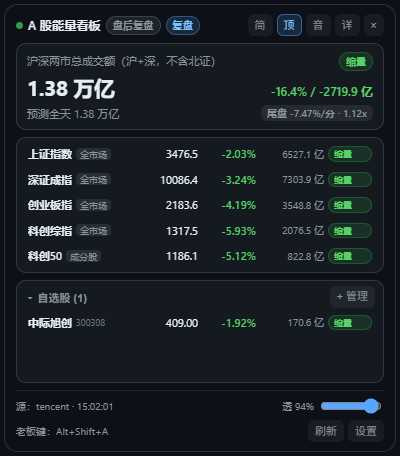
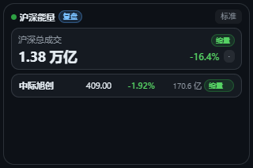
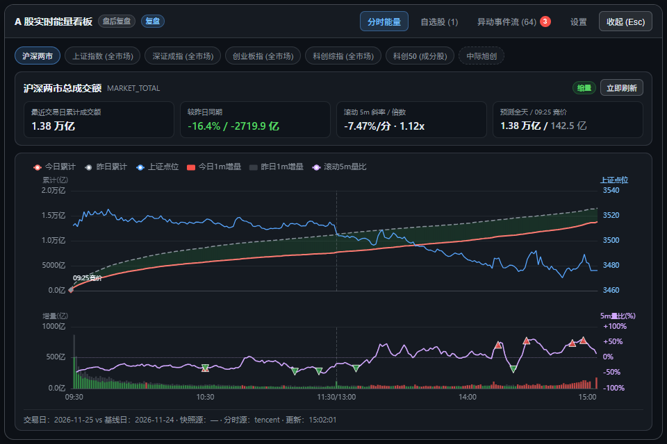
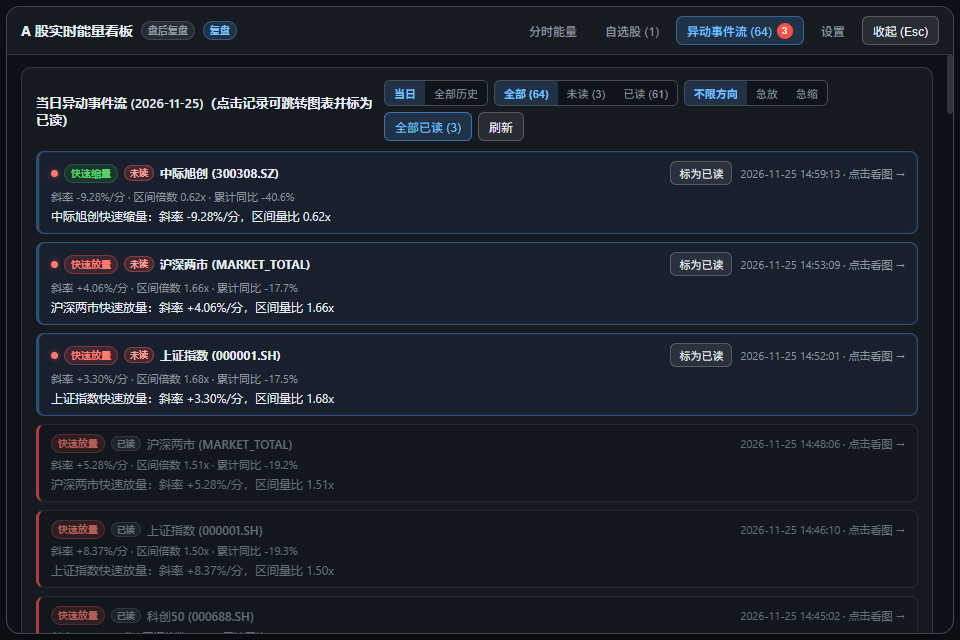
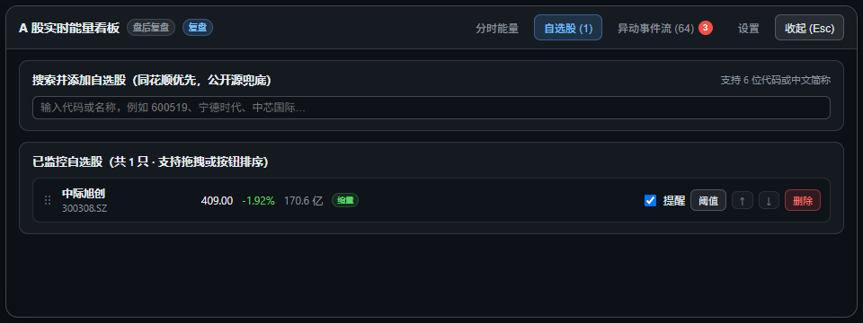
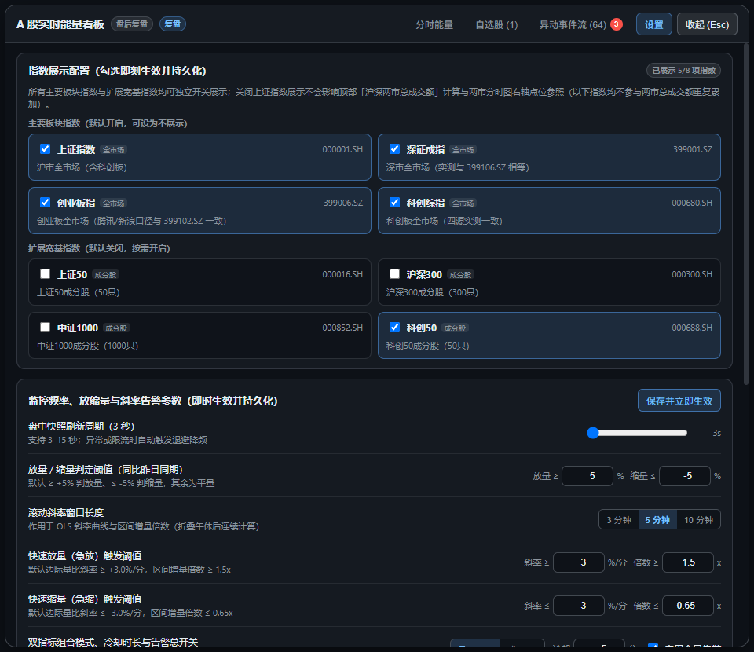

# A 股实时能量看板（ashare-volpulse）

Windows / macOS 桌面端 A 股盘中实时量能监控与分析工具，采用 **紧凑悬浮窗 HUD + 可展开详情浮层 + 系统托盘/菜单栏** 形态（无独立浏览器 Web 页面），专注实时追踪沪深两市总成交额、四大核心指数与自选个股的放缩量状态及快速异动趋势。

> **技术栈**：Electron 45 · TypeScript · React 19 · ECharts 6 · Electron 内置 `node:sqlite`（零 MSVC / `node-gyp` 编译依赖）

---

## 这一版多了什么

- **悬浮窗附加信息**：韩国综指、国家队是否上班（20 只宽基 ETF 的同时点放量倍数与主动净买入）、涨跌停家数、涨跌家数条。
- **提醒说人话并留痕**：放量 / 缩量提醒写成"最近几分钟的成交是昨天同时段的几倍"，最近 3 条常驻在悬浮窗上，两分钟内多个指数一起触发的合并成一行。
- **较昨日同期曲线**：详情分时图第三行，逐分钟显示今天累计成交比昨天同一时刻多或少百分之几。
- **「情绪」页**：涨跌分布、涨停 / 跌停 / 封板率（今日对昨日）、连板梯队与连板率、连板股名单。
- **悬浮窗可调大小**：右下角左右拖整体放大，底边上下拖只改高度，双击恢复默认。
- **10 秒增量**：总成交区显示最近约 10 秒进了多少成交额。
- 附加数据全部由应用自己取（Naver、东方财富、腾讯、新浪的公开接口），不需要另外装任何服务；收盘后取到一次收盘值就不再请求。

> 没有做 Apple / Windows 的付费代码签名。macOS 首次打开请右键 →「打开」，或在终端执行 `xattr -cr /Applications/A股能量看板.app`。
> 所有数据来自公开行情接口，不保证稳定；本工具只是看盘辅助，不构成任何买卖建议。

---

## 界面预览

### 紧凑悬浮窗 HUD（标准模式 / 极简模式）

| 标准模式（两市总成交 + 核心/扩展指数 + 自选股） | 极简模式（两市总成交 + 前 3 条自选股） |
| :---: | :---: |
|  |  |

### 详情浮层 · 分时能量双图联动



### 详情浮层 · 异动事件流（已读 / 未读区分 & 全部已读）



### 详情浮层 · 自选股管理



### 详情浮层 · 指数展示配置与热生效设置



---

## 核心功能

### 1. 双态悬浮窗与桌面体验
- **紧凑 HUD 悬浮窗**：无边框透明圆角、始终置顶、不占任务栏，支持拖拽并自动记忆屏幕位置与透明度（30%–100%），支持 **标准模式 / 极简模式** 一键切换，遵循 A 股 **红涨绿跌** 视觉规范。
  - **Hero 区**：沪深两市总成交额、较昨日同期百分比与差额、全天预测成交额、趋势斜率脉冲箭头。
  - **核心板块与可选扩展指数**：默认展示「上、深、双创」全市场指数（上证指数、深证成指、创业板指、科创综指，均支持在设置中单独关闭展示），并可按需开启 **上证50、沪深300、中证1000、科创50**（默认关闭），统一展示点位、涨跌幅、成交额、口径角标与放/平/缩量徽章。
  - **自选股精简列表**：可折叠/滚动，展示现价、涨跌幅、成交额与放缩量状态；点击任意标的直达详情图表。
- **详情浮层窗口**：点击 HUD 展开按钮或任意标的贴近 HUD 弹出（空间不足自动居中），失焦不销毁，按 `Esc` 或点击收起隐藏。
- **系统托盘与全局老板键**：
  - 托盘右键覆盖显隐悬浮窗、极简/标准模式切换、展开详情、置顶、静音、开机自启、手动刷新、设置与退出；悬停 Tooltip 实时展示两市总成交额与放缩/降级状态；关闭窗口默认最小化至托盘。
  - 默认全局老板键 `Alt+Shift+A` 一键隐藏 / 恢复所有窗口（精确恢复隐藏前状态），支持运行时改绑与快捷键冲突提醒。

### 2. ECharts 上下联动分时能量图
- **严格折叠 `11:30–13:00` 午休**，`09:25` 集合竞价独立锚点标注，不混入连续竞价斜率窗口；盘后自动执行收盘终态分时校准，完整保留 `14:57–15:00` 尾盘集合竞价成交额。
- **上图**：今日累计成交额实线 vs 昨日同期累计虚线（交叉精确计算的放量淡红 / 缩量淡绿填充区）+ 右轴叠加分时价 / 指数点位。
- **下图**：今/昨 1 分钟增量对比柱 + 滚动 $W$ 分钟边际量比曲线（`3 / 5 / 10` 分钟可调）+ 急放/急缩异动散点标记。
- 单 ECharts 实例复用增量更新，3 秒高频刷新无闪烁、无实例泄漏。

### 3. 自选股管理、事件流与实时设置
- **自选股管理**：按代码或中文名防抖搜索添加（同花顺元信息优先，东财/腾讯公开源兜底），支持拖拽与按钮排序、删除、单股提醒开关及单股自定义告警阈值覆写。
- **异动事件流**：按时间倒序展示当日 / 全部历史急放与急缩触发记录，**区分已读 / 未读状态**（顶部页签未读红点计数、未读高亮与红点标记），支持按 `全部 / 未读 / 已读` 与方向组合筛选、单条标记已读、**一键全部已读**，点击任意记录可直达对应标的图表并自动标为已读。
- **多通道告警**：写库（`alert_events`）→ Windows 原生通知（含标的名、方向、斜率、区间倍数）→ HUD 红/绿呼吸高亮 → Web Audio 区分急放/急缩短提示音（静音仅屏蔽声音，其余通道照常）。
- **热生效配置**：扩展指数开关、刷新周期（3–15 秒）、放/平/缩阈值、斜率窗口、急放/急缩阈值、「且/或」组合模式、冷却分钟数修改后即时生效并持久化。

---

## 大盘口径与核心算法

### 1. 大盘成交额防重复累加口径
| 展示对象 | 标准代码 (`thscode`) | UI 口径角标 | 说明 |
| --- | --- | --- | --- |
| **沪深两市总成交额** | `000001.SH` + `399106.SZ` | `两市全市场` | 沪市全市场（含科创板）+ 深市全市场（含创业板），**不含北证**，绝不直接叠加各指数 |
| 上证指数 *(默认开启，可关闭)* | `000001.SH` | `全市场` | 沪市全市场成交额（关闭展示不影响顶部两市总成交额聚合） |
| 深证成指 *(默认开启，可关闭)* | `399001.SZ` | `全市场` | 实测四源均返回深市全市场成交额（同 `399106.SZ`） |
| 创业板指 *(默认开启，可关闭)* | `399006.SZ` | `全市场` | 腾讯/新浪口径等于创业板全市场（同 `399102.SZ`） |
| 科创综指 *(默认开启，可关闭)* | `000680.SH` | `全市场` | 实测四源均返回科创板全市场成交额 |
| 上证50 / 沪深300 / 中证1000 / 科创50 *(默认关闭，可开启)* | `000016.SH` / `000300.SH` / `000852.SH` / `000688.SH` | `成分股` | 各宽基成分股成交额，按需开启，不参与两市总成交额累加 |

### 2. 核心量能与告警公式（统一纯引擎 `src/core/`）
大盘聚合、四大指数与所有自选股共用 `src/core/` 下的同一套纯 TypeScript 引擎：

- **昨日同期累计对比**：盘中未闭合分钟按已过秒数 $s/60$ 对昨日同分钟做线性插值，避免每分钟前几秒产生假骤缩锯齿；同比偏离默认 $\ge +5\%$ 判放量、$\le -5\%$ 判缩量。
- **全天预测成交额（多日分时占比 + 剩余时段贝叶斯收缩）**：
  - 取本地 SQLite 最近最多 `10` 个历史完整交易日计算平均分钟累计占比 $\bar{w}(t)$（不足时自动回退已有天数 / 昨日）；
  - 将全天拆分为「已成交部分 + 剩余时段预测」，按置信权重 $\alpha(t)=\frac{\bar{w}(t)}{\bar{w}(t)+\lambda}$（默认 $\lambda=0.12$）平滑收缩剩余时段倍率，消除开盘前几分钟单日高/低开带来的预测剧烈失真，且保证平量无偏、收盘零误差。
- **滚动边际量比与趋势斜率**：
  - 计算最近 $W$ 分钟边际成交额相对昨日同一 $W$ 分钟的区间倍数 $M_W(t)$ 与偏离 $D_W(t)=(M_W(t)-1)\times 100\%$（自动剔除 `09:25` 集合竞价干扰，早盘与尾盘量纲完全一致，无午后大基数钝化）；
  - 对最近 $W$ 个连续时刻的 $D_W(k)$ 做 OLS 线性回归得到边际趋势斜率 $S_W(t)$（单位：百分点/分钟）；
  - `09:30–09:34` 冷启动保护不触发斜率告警；默认急放 $S_W \ge +3.0\%/\text{分}$ 且 $M_W \ge 1.5\text{x}$，急缩 $S_W \le -3.0\%/\text{分}$ 且 $M_W \le 0.65\text{x}$，同标的同方向默认 5 分钟冷却防刷屏。
- **真实数据完整性**：上游缺失或延迟时界面显式标注「降级 / 陈旧」，绝不对缺失成交额补零，绝不用模拟数据冒充实盘行情。

---

## 数据源策略与安全卫生

### 1. 各数据源职责总览

项目内置 4 个上游行情数据源适配器（`src/main/providers/`）与本地 SQLite 缓存层，由主进程调度器（`PollingScheduler`）统一编排：

| 数据源 | 适配器 | 核心职责 | 特点与边界 |
| --- | --- | --- | --- |
| **腾讯财经** (`tencent`) | `tencentProvider.ts` | **主力快照源** + **主力 1 分钟分时源** + 搜索兜底 | 高频稳定、延迟低；与新浪在全标的（含 `399006.SZ`）成交额口径 100% 一致；`day/query` 一次返回近 5 个交易日 1 分钟数据 |
| **新浪财经** (`sina`) | `sinaProvider.ts` | **快照第一备源** + 交易日历降级开市探测 | 高频稳定且与腾讯口径完全一致，支持无缝热切换；公开接口无 1 分钟成交额分时，不参与分时补齐 |
| **东方财富** (`eastmoney`) | `eastmoneyProvider.ts` | **1 分钟分时第一备源** + 搜索第一备源 + `399006.SZ` 口径对齐 | `push2his` 支持 2 日 1 分钟增量成交额；因 `push2` 高频快照会触发连接级断连（`UND_ERR_SOCKET`），**不接入**实时快照轮询链路 |
| **同花顺 Fuyao** (`hithink`) | `hithinkProvider.ts` | **权威交易日历** + **权威标的搜索** + **快照紧急低频兜底** | 需配置 API Key；受 `code=4001` 动态限流约束，严禁高频轮询；无历史分钟线接口；快照不返回中文名且 `399006.SZ` 口径与腾讯/新浪存在差异 |

### 2. 优先级与降级顺序

| 业务职责 | 优先级与降级链路 | 触发条件与恢复策略 |
| --- | --- | --- |
| **盘中高频批量实时快照**<br>（默认 3s，可配 3–15s） | **腾讯财经** `qt.gtimg.cn`<br>→ **新浪财经** `hq.sinajs.cn`<br>→ **同花顺 Fuyao**（仅配置 Key 时，强制降频 ≥ 15s） | 遇限流（429/403）**立即切源**，或连续失败 **3 次**切源；失败期间指数退避翻倍（上限 30s），切源后立即补拉一次。切离主源后每 **5 分钟**探测腾讯健康状态，恢复即切回；滞留同花顺时同步探测新浪，优先脱离低频兜底。若切至同花顺，对 `399006.SZ` 禁止混写跨口径快照并尝试通过东财分时重拉 2 日基线以保持「今/昨同源」。 |
| **今/昨 1 分钟分时基线补齐**<br>（启动 / 盘前 / 缺口 / 新增自选） | **本地 SQLite 缓存**<br>→ **腾讯财经** `day/query`（近 5 日）<br>→ **东方财富** `push2his trends2`（2 日） | 优先读取本地缓存；仅在昨日不足 240 根、今日有缺口或缺少竞价锚点时联网补齐（并发度 2、间隔 150ms、单标重试冷却 120s）。双源均失败时标注降级，绝不补零。 |
| **交易日历**<br>（开市判定与上一交易日） | **SQLite 当日缓存**<br>→ **同花顺 Fuyao** `/api/a-share/calendar/trading-days`<br>→ **SQLite 旧缓存**（若覆盖今日）<br>→ **公开源降级推断**（腾讯→东财分时日期 + 腾讯→新浪快照开市探测） | 每日首次启动同步 1 次并缓存。降级推断时，若工作日尚未出现在分时日期中，会在 `09:15–15:10` 通过腾讯→新浪单次快照探测今日是否开市（`09:35` 前每 30 秒复探，超 `09:35` 仍无今日行情则判为法定节假日休市），同时界面标注日历降级态。 |
| **自选股搜索与代码消歧** | **同花顺 Fuyao** `/api/meta/tickers/search`<br>→ **东方财富** `searchapi` 联想<br>→ **腾讯财经** `smartbox` | 未配置 Key、请求异常或返回为空时，自动顺次降级至下一公开联想源。 |

### 3. 不配置同花顺 API Key 时的运行说明（开箱即用）

> **同花顺 API Key 为完全可选配置**：不配置 Key 时软件仍可借助腾讯、新浪、东方财富公开接口完整运行盘中实时监控、图表绘制、自选股管理与告警功能，不会阻塞启动。具体差异如下：
>
> - **完全不受影响**：盘中 3 秒实时快照（腾讯主源 + 新浪无缝热备）、今/昨 1 分钟分时基线补齐（腾讯主源 + 东财备源）、沪深两市总成交额聚合、放缩量/全天预测/滚动斜率计算、桌面告警与本地 SQLite 30 交易日留存均正常工作。
> - **交易日历自动降级推断**：无法拉取权威年度交易日历，改由「SQLite 历史缓存 + 腾讯/东财近 5 日分时 + 工作日开盘窗内腾讯/新浪单次快照探测」自动识别今日是否开市；界面状态栏会显示**日历降级提示**（`inferred_degraded`），且节假日前后的首次启动可能需等到 `09:15–09:35` 探测确认。
> - **自选股搜索改走公开源**：自动跳过同花顺元信息，直接由 **东方财富 → 腾讯** 公开联想接口完成搜索，响应更快（<150ms），满足常规 A 股与指数添加需求。
> - **无第三层紧急快照兜底**：若极端情况下腾讯与新浪公开快照**同时**不可用，不会切入同花顺 15 秒低频兜底，而是按指数退避持续重试并标注数据陈旧/降级，待任一公开源恢复后自动续传。

### 4. 同花顺 Fuyao API 接入与安全卫生

- **官方仓库与文档**：[HiThink-Tech/Financial-API](https://github.com/HiThink-Tech/Financial-API)（同花顺金融数据服务 REST API / CLI / MCP 官方契约仓库）
- **API Key 申请地址**：前往 [同花顺 Fuyao 管理后台](https://fuyao.aicubes.cn/admin) 注册并获取统一 API Key。
- **API Key 安全读取优先级**（严禁写入代码、Git、URL 或日志）：
  1. 软件内设置页加密存储（Electron `safeStorage`：Windows DPAPI / macOS Keychain，保存后即清空输入框、永不回显明文；保存后会即时重载权威交易日历并解除日历降级提示）；
  2. 环境变量 `HITHINK_FINANCE_API_KEY`；
  3. 用户级 `credentials.env`：Windows `%APPDATA%\hithink-finance\credentials.env`、macOS `~/Library/Application Support/hithink-finance/credentials.env`。
- **自适应退避与非交易休眠**：午休（`11:30–13:00`）、盘后与休市自动停止高频轮询，进入低功耗复盘模式展示最近交易日数据；使用 Electron 内置 `node:sqlite` 滚动保留近 **30 个交易日** 数据，存储于系统 `%APPDATA%` 目录，不污染程序目录。

---

## 快速开始

### 环境要求
- Windows 10 / 11（x64）或 macOS 12+（Apple Silicon `arm64` / Intel `x64`）
- Node.js 22+（推荐 Node 24/26，无需安装 Visual Studio / MSVC）

### 安装与运行
```bash
# 安装依赖（零本地 C++ 编译）
npm install

# 启动本地开发模式（含 HMR）
npm run dev
```

### 常用命令
```bash
# TypeScript 严格类型检查（主进程 + 渲染进程）
npm run typecheck

# 运行全套 Vitest 单元测试
npm run test

# 构建 Electron 生产产物（out/）
npm run build

# 打包 Windows 绿色解压版 .zip（自动同步最新 git tag 版本，输出至 release/）
npm run package:win

# 打包 macOS Apple Silicon + Intel 安装包 .dmg（需在 macOS 下执行）
npm run package:mac
```

> **macOS 首次运行提示**：自动构建产物当前未做 Apple 开发者公证，若首次双击提示「无法验证开发者」或「已损坏」，请在终端执行 `xattr -cr "/Applications/A股能量看板.app"` 后重新打开，或在「系统设置 → 隐私与安全性」中点击「仍要打开」。

### 双平台自动发布（GitHub Release）
项目已配置 [.github/workflows/release.yml](.github/workflows/release.yml)，推送 `v*` 格式标签即可自动并行构建 Windows（x64 免安装解压版 `.zip`）与 macOS（`arm64` / `x64` `.dmg`）并附带 `SHA256SUMS.txt` 发布至 GitHub Release：

```bash
git tag v0.1.0
git push origin v0.1.0
```

### 全天真实数据回放验证（开发态）
应用正常运行录制了本地交易日分钟数据后，可通过回放模式重演 `09:25 → 15:00` 全流程（不发起实时轮询、回放告警标记为 `[回放]` 且不写入实盘 `alert_events`、不弹系统通知）：

```bash
# 方式 1：只读离线全天回放校验脚本（默认读取 %APPDATA%\ashare-volpulse\ashare-volpulse.sqlite，兼容旧目录）
npm run verify:replay
node scripts/verify-replay.mjs --db <sqlite路径> --date 2026-11-24

# 方式 2：启动 Electron 桌面界面加速回放指定交易日
npm run build
npx electron . --replay 2026-11-24 --replay-step-ms=100
```

---

## 目录结构

```text
ashare-volpulse/
├── docs/
│   ├── PLAN.md                   # 权威实施计划、领域规范与数学公式
│   ├── DATA_SOURCES.md           # 数据源实测调研、口径核验与限流预算
│   ├── images/                   # README 功能界面截图
│   └── specs/                    # Phase 0–6 分阶段详细规格
├── scripts/
│   ├── spike-data-sources.mjs    # 数据源可用性与限流探针脚本
│   └── verify-replay.mjs         # 本地真实录制交易日全天回放校验脚本
├── src/
│   ├── shared/                   # 前后端共享类型、IPC 契约、常量、图表数据构建
│   ├── core/                     # 纯 TypeScript 领域引擎（时钟、聚合、量能预测、告警）
│   ├── main/                     # Electron 主进程
│   │   ├── providers/            # 腾讯 / 新浪 / 东财 / 同花顺适配器
│   │   ├── scheduler/            # 自适应分层轮询与容错调度器
│   │   ├── replay/               # 全天历史回放引擎（--replay）
│   │   ├── storage/              # node:sqlite 持久层、配置/自选股服务、safeStorage 密钥库
│   │   ├── windows/              # HUD / 详情浮层几何定位与双态窗口管理
│   │   ├── tray/                 # 动态系统托盘与全局老板键管理
│   │   └── alerts/               # 多通道告警派发器（落库 + 系统通知 + IPC）
│   ├── preload/                  # contextBridge 类型安全桥接
│   └── renderer/                 # React + ECharts 渲染进程（HUD、详情浮层、Web Audio 提示音）
├── tests/                        # Vitest 单元测试（core / providers / scheduler / storage / shell / replay / renderer）
├── electron-builder.yml          # Windows 便携版打包配置
└── package.json
```

---

## 文档与说明

- 详细设计与公式定义见 [docs/PLAN.md](docs/PLAN.md)
- 数据源实测口径与限流结论见 [docs/DATA_SOURCES.md](docs/DATA_SOURCES.md)
- 开源协议：[MIT License](LICENSE)

> **免责声明**：本项目仅用于 A 股盘中成交额与量能变化的本地实时可视化监控与复盘研究，不构成任何投资建议，也不包含任何自动下单或交易执行功能。
